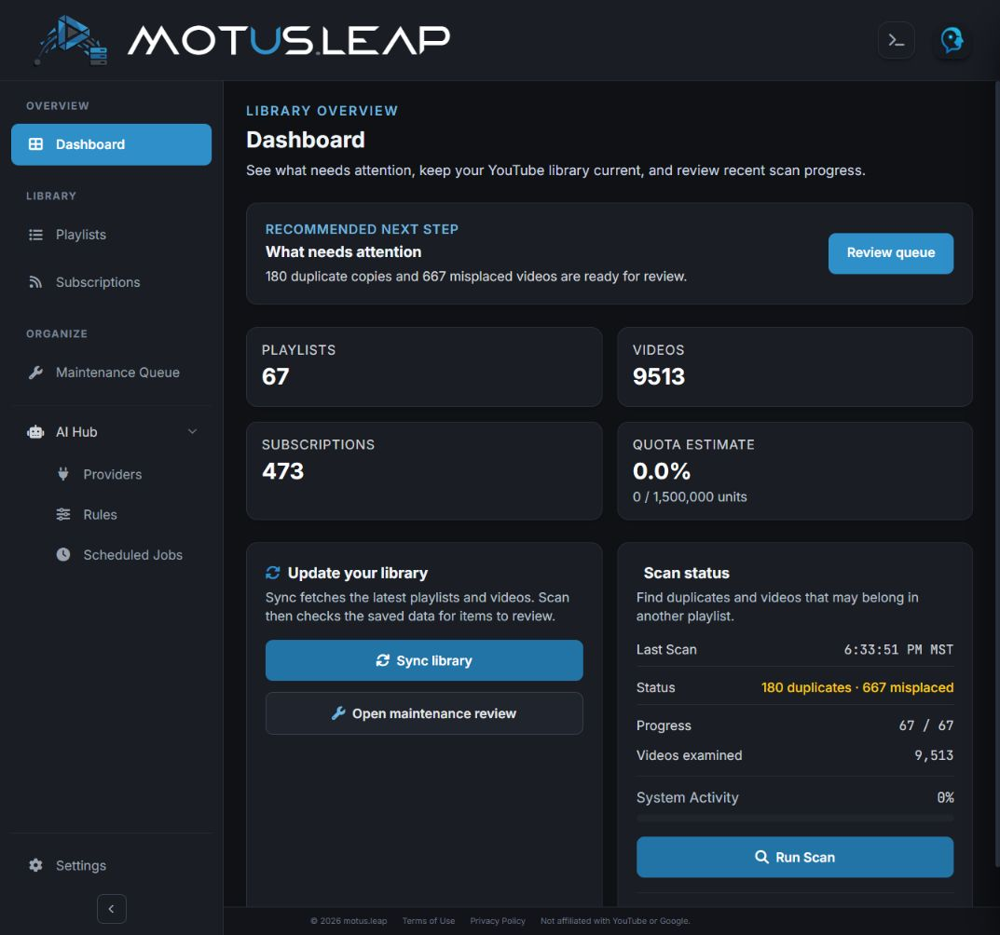
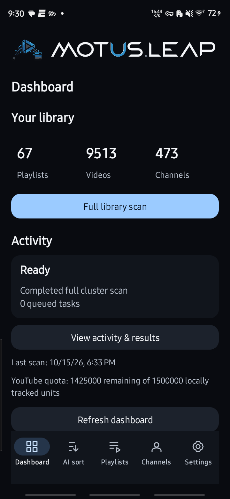
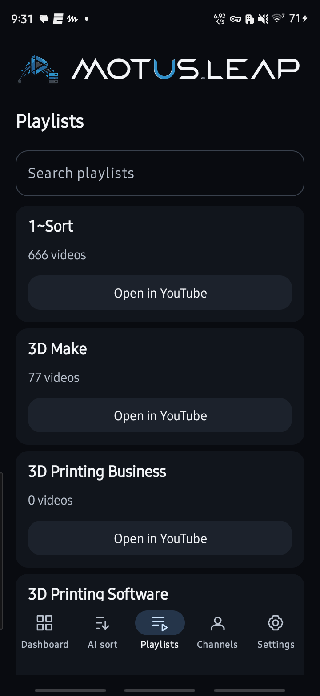
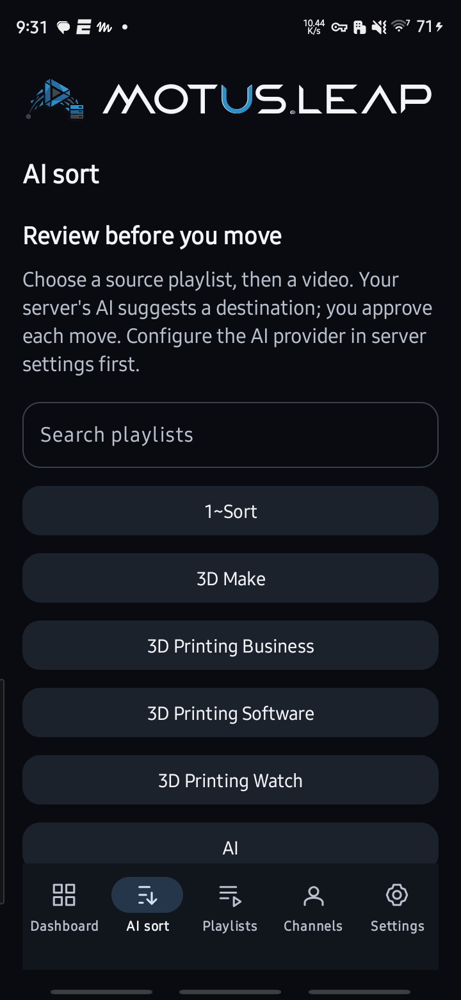
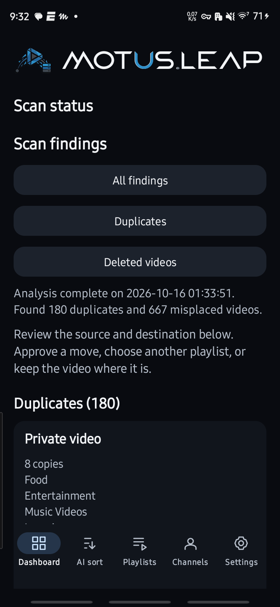

# motus.leap

**A place for every video.** motus.leap is a self-hosted web workspace that brings order to your YouTube™ library with channel-to-playlist rules and AI suggestions you review, plus an optional Android companion app. Nothing moves until you confirm it.

Published by **Atomic 22 Industries**.

[Website](https://dave-patrick.github.io/motus.leap/) · [Help](https://dave-patrick.github.io/motus.leap/help.html) · [Android download (0.5.2)](https://github.com/dave-patrick/motus.leap/releases/tag/v0.5.2) · [Report an issue](https://github.com/dave-patrick/motus.leap/issues)


> **Status:** development build. The Android app (0.5.2) is a debug-signed prerelease, and the server is something you run and configure yourself. There is no hosted public service.

<p>
  
  &nbsp;
  
</p>

---

## What it does

- **Web workspace** – browse playlists and subscriptions, see what needs attention, and manage everything from any browser.
- **Channel-to-playlist rules** – send videos from a known channel to the same playlist every time.
- **AI suggestions you approve** – the server sends a video's title, channel and description to the AI provider you configure (OpenAI, Anthropic, Groq, OpenRouter or a custom OpenAI-compatible endpoint) and suggests a destination playlist. Every move waits for your confirmation; a suggestion that doesn't match a known playlist can't start one.
- **Library scans** – full library scan, duplicate scan, misplaced-video scan and playlist sync. Work runs in the background on your server, and queued work is reported separately from completed work.
- **Maintenance queue** – review duplicates and misplaced videos, keep or move them, individually or in bulk.
- **Scheduled jobs** – run scans and AI rules on a schedule from the AI Hub.
- **Watch Later transfer** – move Watch Later items into a sorting playlist (needs a signed-in YouTube browser session on the server).
- **Android companion** – native Android screens for the dashboard, playlists, channels, scans and reviewed AI sorting, connected to the same server.
- **Quota tracking** – a daily YouTube API quota guard, shown on the dashboard.

## How it fits together

| Piece | Where it runs | What it does |
|---|---|---|
| **Web workspace** | Your browser | The main interface: rules, scans, review queue, AI Hub, settings. |
| **motus.leap server** | A server you configure (FastAPI) | Stores YouTube™ credentials, runs background jobs, talks to YouTube and your AI provider, serves the web workspace. Must be reachable over HTTPS for the Android app. |
| **Android app** (optional) | Your phone, Android 8.0+ | Companion to the same server. Signs in with Google in the system browser. |
| **YouTube™ and AI provider** | Third-party services | Authorised separately on the server. |

Signing in to motus.leap and authorising the server to access your YouTube account are separate steps. Downloading the APK alone does not create a server or connect a YouTube account.

---

## Quick start (server and web workspace)

### Prerequisites

- Python 3.11 or newer
- A Google Cloud project with the **YouTube Data API v3** enabled and an **OAuth 2.0 web client** (client ID and secret)
- Optional: an API key for an AI provider, if you want sorting suggestions

### Install and run

```bash
git clone https://github.com/dave-patrick/motus.leap.git
cd motus.leap
python -m venv .venv
source .venv/bin/activate        # Windows: .venv\Scripts\activate
pip install -r requirements.txt
playwright install chromium      # needed for Watch Later features
```

Create a `.env` file (or set environment variables) with at least:

```bash
GOOGLE_OAUTH_CLIENT_ID=your-client-id.apps.googleusercontent.com
GOOGLE_OAUTH_CLIENT_SECRET=your-client-secret
GOOGLE_OAUTH_REDIRECT_URI=http://localhost:8000/api/auth/google/callback
FRONTEND_URL=http://localhost:8000
TUBE_MANAGER_SECRET_KEY=a-long-random-string
TUBE_MANAGER_DATA_DIR=./data
```

Add the same redirect URI to your OAuth client in Google Cloud, then start the server:

```bash
uvicorn app:app --host 0.0.0.0 --port 8000
```

Open `http://localhost:8000`, sign in with Google, connect your YouTube account, and add an AI provider in **AI Hub → Providers** if you want suggestions.

### Deploy on Render

`render.yaml` defines a single web service with a persistent disk at `/app/data`. Set `GOOGLE_OAUTH_CLIENT_ID` and `GOOGLE_OAUTH_CLIENT_SECRET` in the Render dashboard, and point the OAuth redirect URI at `https://<your-service>.onrender.com/api/auth/google/callback`. The Android sign-in handoff store is in memory, so keep the service to a single process.

### Configuration

| Variable | Required | Purpose |
|---|---|---|
| `GOOGLE_OAUTH_CLIENT_ID` | Yes | Google OAuth web client ID (`YOUTUBE_CLIENT_ID` is accepted as an alias). |
| `GOOGLE_OAUTH_CLIENT_SECRET` | Yes | Google OAuth client secret (`YOUTUBE_CLIENT_SECRET` alias). |
| `GOOGLE_OAUTH_REDIRECT_URI` | Yes | OAuth callback, ending in `/api/auth/google/callback`. |
| `FRONTEND_URL` | Yes | Public base URL of your server. |
| `TUBE_MANAGER_SECRET_KEY` | Yes | Secret used to sign sessions. Use a long random value. |
| `TUBE_MANAGER_DATA_DIR` | Recommended | Where users, settings, caches and scan results are stored. |
| `TUBE_MANAGER_ADMIN_PASSWORD` | Optional | Initial admin password. If unset, a random one is generated and written to the log. |
| `YOUTUBE_DAILY_QUOTA` | Optional | Daily YouTube API quota for the quota guard (default `1500000`). Set this to your approved allowance. |
| `YOUTUBE_API_KEY` | Optional | API key for read-only YouTube requests. |
| `EXTRA_ALLOWED_ORIGINS` | Optional | Extra CORS origins, comma separated. |
| `REDIS_URL` | Optional | Use Redis for caching instead of in-memory. |
| `SENTRY_DSN` | Optional | Error reporting. |
| `CSP_STRICT` | Optional | Enable the stricter Content Security Policy. |

AI provider keys are added in the web workspace (**AI Hub → Providers**), not as environment variables. Saved keys are never shown again in the interface.

---

## Android app

The Android companion is a native app (not a WebView) for Android 8.0 or newer.

- **Download:** [motus.leap 0.5.2 prerelease](https://github.com/dave-patrick/motus.leap/releases/tag/v0.5.2) (debug-signed APK with SHA256 checksums).
- **Connect:** enter your server's HTTPS address and tap **Continue with Google**. Sign-in completes in the system browser; the session is stored encrypted with Android Keystore.
- **Build from source:** see [`android/README.md`](android/README.md) (JDK 17+, Android SDK 36, `./gradlew assembleDebug`).

Debug-signed builds from different machines use different certificates and can't update each other's installs. Don't uninstall to work around this; that deletes app data.

<p>
  
  
  
</p>

---

## Command line

`cli.py` offers a few direct commands against the YouTube API:

```bash
python cli.py list "Playlist name"
python cli.py add <video-url> "Playlist name"
python cli.py remove <video-url> "Playlist name"
python cli.py create <video-url> "New playlist"
python cli.py scan [--force]
python cli.py auto-sort
```

## Development

```bash
pip install pytest pytest-asyncio pytest-cov
python -m pytest tests/ -q
```

CI runs the test suite on Python 3.11 and 3.12 (`.github/workflows/test.yml`), builds the Android app (`android-build.yml`) and publishes the website from `site/` to GitHub Pages (`pages.yml`).

### Repository layout

| Path | Contents |
|---|---|
| `app.py`, `server.py` | FastAPI application entry points |
| `api/`, `routers/` | REST endpoints: auth, playlists, maintenance, rules, bulk operations |
| `services/` | YouTube client, AI classifier and chat, background worker, scans, quota ledger |
| `core/` | HTTP client, caching, config, logging, rate limiting, observability |
| `models/` | Data types |
| `web/` | The web workspace (HTML, JS, CSS) |
| `android/` | Android companion app |
| `site/` | Public landing page and help ([live](https://dave-patrick.github.io/motus.leap/)) |
| `tests/` | Unit, integration, security and load tests |
| `documentation/`, `docs/` | Publishing notes, release notes, audits |

## Documentation

- [Website help](https://dave-patrick.github.io/motus.leap/help.html): setup, options and practical limits
- [`android/README.md`](android/README.md): Android build, sign-in and release history
- [`documentation/PUBLISHING.md`](documentation/PUBLISHING.md): how the website and releases are published
- [`documentation/RELEASE-0.5.1.md`](documentation/RELEASE-0.5.1.md): release notes

## Security and privacy

- Your server holds the YouTube™ credentials. The Android app never contains server secrets or the Google client secret.
- AI sorting sends video titles, channel names and descriptions to the AI provider you configure. No suggestion moves anything without your confirmation.
- Report problems through [GitHub issues](https://github.com/dave-patrick/motus.leap/issues). Never include API keys, tokens or other secrets in an issue.

## License

Apache-2.0. See [LICENSE](LICENSE).

YouTube™ is a trademark of Google LLC. motus.leap is an independent project and is not affiliated with, endorsed by, or sponsored by Google LLC or YouTube.
